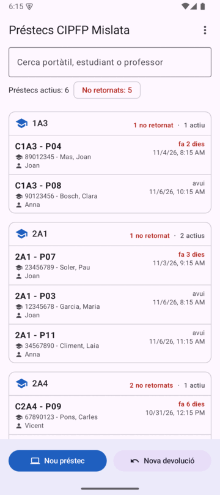
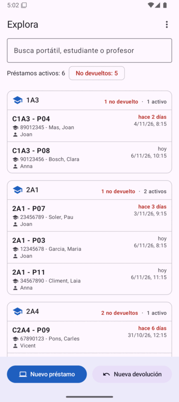
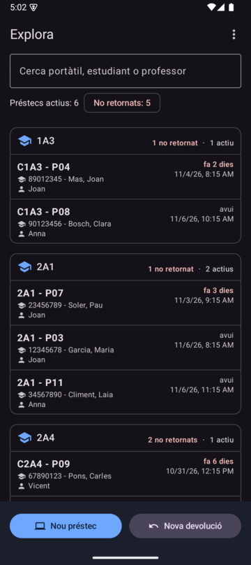
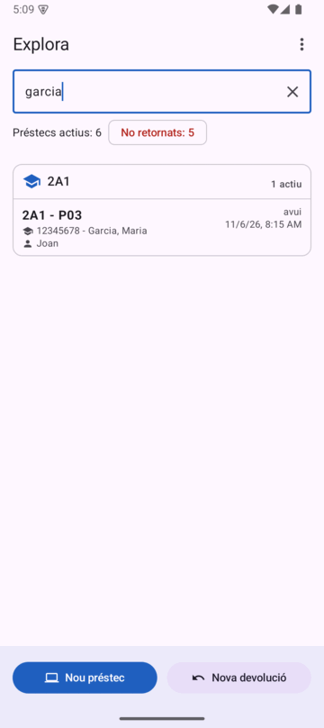
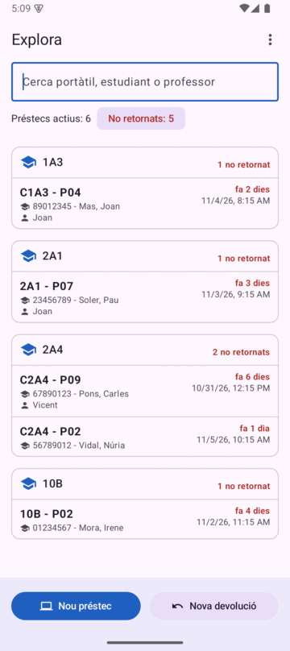
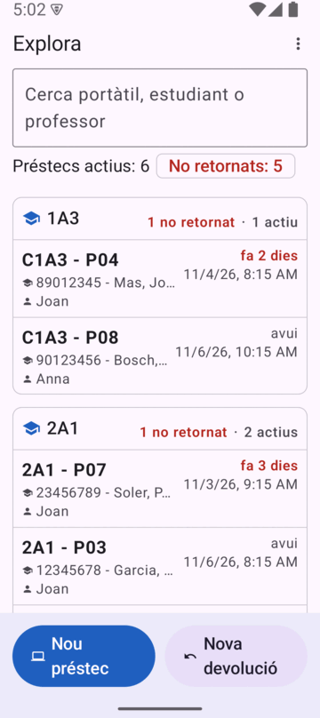
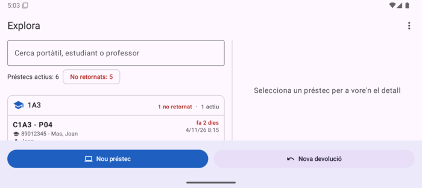
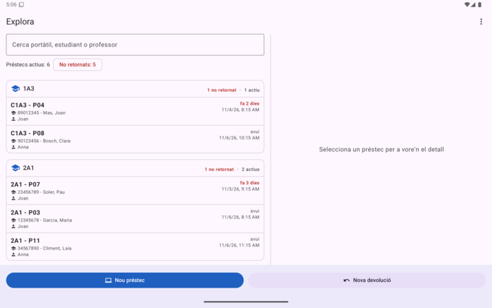
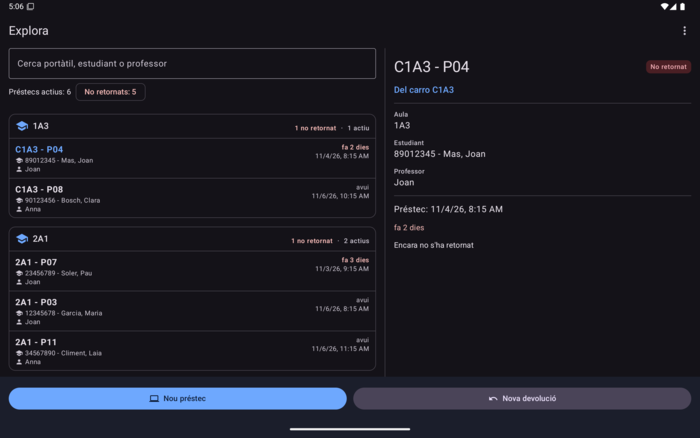

# Préstecs CIPFP Mislata

__Préstecs CIPFP Mislata__ és una aplicació Android, feta amb Kotlin i Jetpack Compose, per a
consultar els préstecs de portàtils d'un centre educatiu. Forma part de la fase 1 del projecte del
mòdul de Programació Multimèdia i Dispositius Mòbils. Parteix d'una aplicació real de préstecs del
centre: en reutilitza l'aspecte i el funcionament de la pantalla principal, i treballa amb dades
d'exemple en memòria.



_Pantalla principal en un mòbil, amb una targeta per aula._

La proposta i l'anàlisi prèvia (temàtica, públic, dispositius i motiu de fer-la nativa) estan en
[`docs/lliurable1.md`](docs/lliurable1.md).

## Funcionalitats

L'aplicació cobreix, en esta fase, el recorregut des de l'arrancada fins a la consulta d'un préstec.

- __Pantalla principal__: una targeta per aula amb els seus préstecs oberts.
- __Cerca i filtre__: es pot cercar per portàtil, estudiant o professorat, i filtrar només els
    __no retornats__. Un comptador indica quants préstecs hi ha actius.
- __Detall del préstec__: en una pantalla pròpia al mòbil, i en un segon panell en una tauleta o amb
    el mòbil en horitzontal.
- __Entrada__: _splash_, presentació de 3 pàgines que es pot saltar, i inici de sessió de Moodle
    __simulat__. Accepta qualsevol usuari i contrasenya que no estiguen buits.
- __Perfil i ajustos__: perfil de la persona usuària, tema clar, fosc o del sistema, pantalla
    «Quant a» i tancament de sessió.
- __Idiomes__: valencià i castellà, en mode clar i fosc.

Els botons _Nou préstec_, _Nova devolució_ i _Històric_ encara no tenen pantalla: mostren un avís
que indica que estaran disponibles en la fase 2.

## Requisits

Per a compilar el projecte calen les ferramentes següents:

- __JDK 17 o superior amb `javac`__: Android Studio ja en porta un.
- __SDK d'Android__ amb la plataforma 37 (`compileSdk`). El projecte usa `targetSdk` 36 i
    `minSdk` 28.

## Compilació i execució

Gradle necessita saber on és l'SDK, per això el primer pas crea el fitxer `local.properties`. Després
es pot generar l'APK, passar les proves i instal·lar l'aplicació en un dispositiu o emulador.

```bash
echo "sdk.dir=$HOME/Android/Sdk" > local.properties
./gradlew assembleDebug          # genera app/build/outputs/apk/debug/app-debug.apk
./gradlew testDebugUnitTest      # executa les 13 proves unitàries
adb install -r app/build/outputs/apk/debug/app-debug.apk
```

## Estructura del projecte

El codi s'organitza per capes: les dades i el repositori, les regles de negoci, la navegació i la
interfície. Cada pantalla té la seua carpeta dins de `ui/screens`.

```text
prestecs/
├── build.gradle.kts, settings.gradle.kts, gradle/libs.versions.toml
├── docs/                      lliurable1.md i captures (img/)
└── app/src/
    ├── main/
    │   ├── AndroidManifest.xml
    │   ├── java/com/joanpuigcerver/prestecs/
    │   │   ├── MainActivity.kt
    │   │   ├── data/model/        Loan, LoanStatus, LoanKind
    │   │   ├── data/repository/   LoanRepository, InMemoryLoanRepository, SampleData
    │   │   ├── domain/            agrupar, filtrar i ordenar préstecs
    │   │   ├── navigation/        Routes.kt, PrestecsApp.kt (Navigation 3)
    │   │   └── ui/                theme, components i screens
    │   └── res/                   values (valencià), values-es (castellà), drawable, mipmap
    └── test/                      proves unitàries
```

## Decisions de disseny

Les decisions següents expliquen per què el projecte és com és.

- __Aspecte de l'aplicació original__: s'ha prioritzat simular-lo, perquè l'ús per part de les
    persones usuàries siga intuïtiu en qualsevol de les plataformes.
- __Dades en memòria amb dates relatives__: `SampleData` calcula les dates a partir del dia actual.
    Així sempre hi ha préstecs d'hui i d'abans, que són els que apareixen com a no retornats.
- __Repositori com a interfície__: amb `LoanRepository`, la fase 2 podrà canviar les dades en
    memòria per una API i una base de dades sense tocar les pantalles.
- __Navigation 3 amb rutes serialitzables__: la pila de pantalles sobreviu al gir del dispositiu.
- __Ordre natural de les aules__: `naturalCompare` fa que `2A1` vaja abans de `10B`, cosa que no
    passaria amb un ordre alfabètic simple.

## Recursos i idiomes

Cap text està escrit en el codi: tots es llegeixen amb `stringResource` o `pluralStringResource`.
Els recursos s'organitzen així:

- __Textos__: `res/values/strings.xml` (valencià, per defecte) i `res/values-es/strings.xml`
    (castellà) tenen les mateixes 73 claus i 4 `plurals`, que cobreixen l'antiguitat del préstec i
    el recompte d'actius i no retornats.
- __Idioma de l'aplicació__: amb `generateLocaleConfig = true` en `app/build.gradle.kts`, Android 13
    o superior mostra els dos idiomes en els ajustos de l'aplicació.
- __Icones__: icona pròpia de l'aplicació i icones vectorials en `res/drawable/`.
- __Previsualitzacions__: l'anotació `@PrestecsPreviews` mostra cada pantalla en clar, fosc,
    valencià, castellà i lletra gran.




_L'aplicació amb l'idioma en castellà i en mode fosc._

## Proves

Les proves es van fer en dos dispositius virtuals: `Pixel_9a_API_35` (mòbil) i `Pixel_Tablet_API_35`
(tauleta). La taula resumeix els casos comprovats.

| Prova                                         | Resultat                          |
|-----------------------------------------------|-----------------------------------|
| _Splash_, presentació i inici de sessió       | Correcte                          |
| Cerca i filtre de «No retornats»              | Correcte                          |
| Detall del préstec (mòbil) i panell (tauleta) | Correcte                          |
| Rotació del mòbil                             | Correcte, l'estat es conserva     |
| Mode fosc                                     | Correcte en mòbil i en tauleta    |
| Lletra gran (escala 1,5)                      | Correcte, sense retallades        |
| Idioma de l'aplicació en castellà             | Correcte                          |





_Cerca per estudiant, filtre de no retornats i lletra gran._



_El mòbil en horitzontal mostra el detall en un segon panell._




_La tauleta en mode clar i en mode fosc._

### Cicle de vida

`MainActivity` escriu cada mètode del cicle de vida en el Logcat, amb l'etiqueta `PrestecsLifecycle`.
En girar el mòbil, Android __destrueix i torna a crear__ l'activitat, i el registre ho mostra:

```text
D PrestecsLifecycle: onPause
D PrestecsLifecycle: onStop
D PrestecsLifecycle: onDestroy (canvi de configuració: true)
D PrestecsLifecycle: onCreate (recreada: true)
D PrestecsLifecycle: onStart
D PrestecsLifecycle: onResume
```

Per això l'estat que no s'ha de perdre (la cerca, el filtre i l'usuari) es guarda amb
`rememberSaveable`, i la pila de navegació, amb `rememberNavBackStack`.

### Proves unitàries

L'ordre `./gradlew testDebugUnitTest` executa 13 proves del model, el repositori i les regles
d'agrupació, cerca i ordre. Totes passen.

### Depuració d'un error

Per a practicar el depurador d'Android Studio es va provocar un error en el filtre de cerca i es va
trobar i corregir amb un punt d'interrupció. El procés, amb captures, està en
[`docs/depurador.md`](docs/depurador.md).

## Problemes resolts

Durant el desenvolupament van aparéixer els problemes següents, amb la causa i la solució de cada un.

| Problema                                                                  | Causa i solució                                                     |
|---------------------------------------------------------------------------|---------------------------------------------------------------------|
| `Toolchain … does not provide the required capabilities: [JAVA_COMPILER]` | El JDK no tenia `javac`: s'usa el JBR d'Android Studio o IntelliJ   |
| `androidx.core:core-ktx:1.19.1 requires … compileSdk 37`                  | Es puja `compileSdk` a 37; `targetSdk` continua en 36               |
| `Unresolved reference 'icons'`                                            | Faltava la dependència `material-icons-core`                        |
| En mode fosc, el login i la presentació tenien el fons clar               | Faltava un `Surface`, que posa el fons i el color del text          |

## Crèdits i llicències

- __Biblioteques__: Jetpack Compose, Material 3 i Navigation 3, amb llicència Apache 2.0.
- __Icones vectorials__: _Material Icons_ de Google, amb llicència Apache 2.0.
