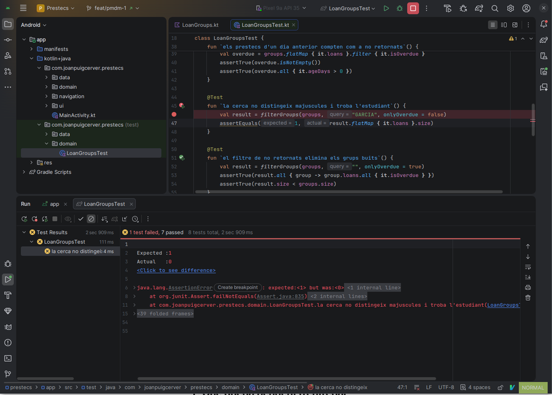
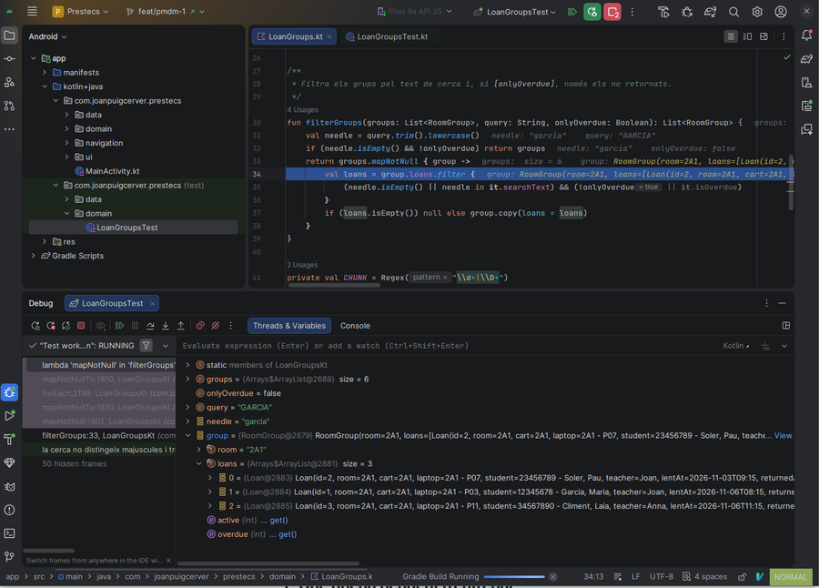
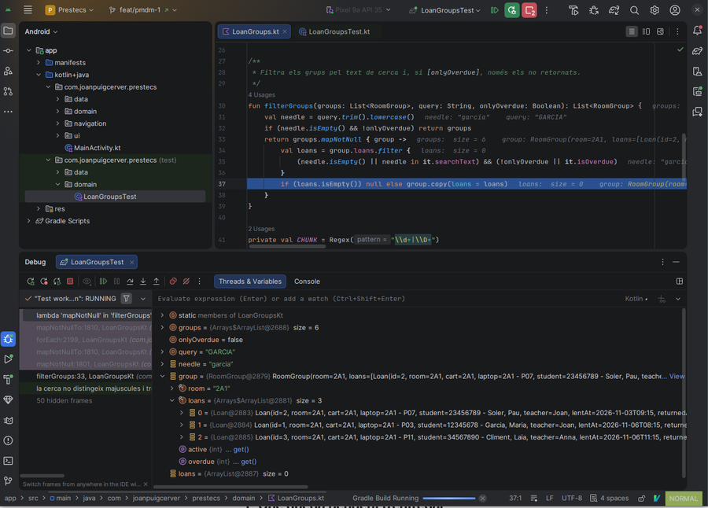
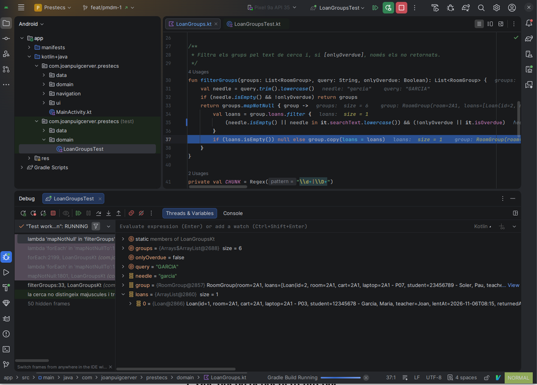
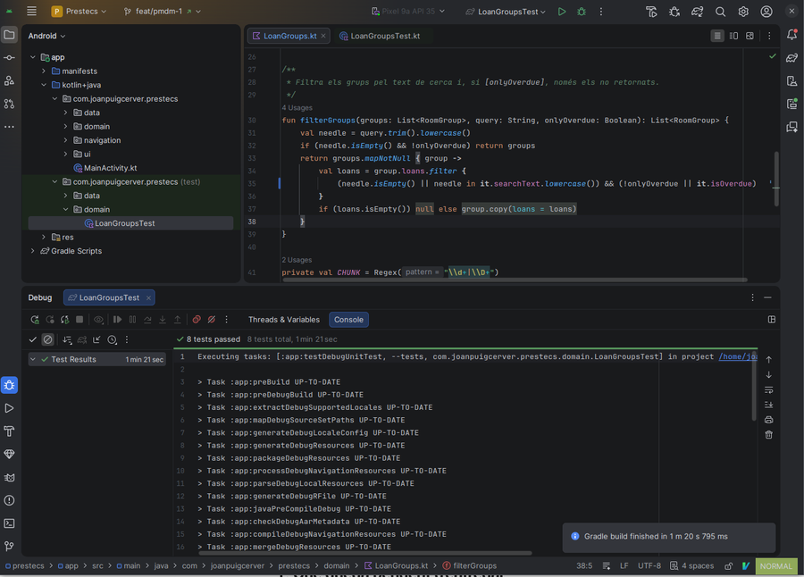

# Depuració d'un error

Per a practicar el depurador d'Android Studio es va introduir **a propòsit** un error en el filtre de
cerca: es va llevar el `.lowercase()` de `Loan.searchText`. A continuació es descriu com es va
trobar i es va corregir.

1. **Símptoma.** La prova `la cerca no distingeix majuscules i troba l'estudiant` falla: s'espera
    un resultat per a la cerca `GARCIA` i n'apareixen 0.

    

2. **Punt d'interrupció.** Es llança la prova amb __Debug__ i s'atura dins de `filterGroups`. Les
    variables mostren que `query` val `"GARCIA"` i que `needle`, ja en minúscules, val `"garcia"`.
    El grup `2A1` té tres préstecs, entre ells el de l'estudiant `Garcia, Maria`.

    

3. **Execució pas a pas.** Amb _Step Over_ s'arriba al final del filtre: la llista `loans` queda
    buida, de manera que el grup `2A1` es descarta, tot i tindre el préstec que es busca.

    

4. **Causa.** `needle` està en minúscules, però `searchText` conserva les majúscules (`Garcia`),
    perquè se li havia llevat el `.lowercase()`. Per això la comparació `needle in it.searchText`
    és sempre falsa.

5. **Correcció.** Amb la sessió en marxa es va provar a passar el text a minúscules en la
    comparació, i `loans` va quedar amb el préstec de `Garcia, Maria`. La correcció definitiva és
    tornar a posar `.lowercase()` a `searchText`, que és on el comentari de la propietat diu que ha
    d'estar.

    

6. **Comprovació.** La prova torna a passar, amb les 8 de `LoanGroupsTest` en verd.

    
