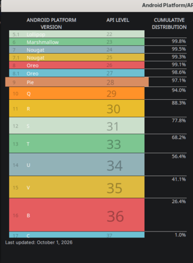

# Lliurable 1: proposta i anàlisi

Este document recull la proposta de l'aplicació **Préstecs CIPFP Mislata** i l'anàlisi prèvia al
desenvolupament: la temàtica i el públic, els dispositius als quals va dirigida, el motiu de fer-la
nativa i les limitacions dels dispositius mòbils que l'afecten.

## Temàtica

**Préstecs CIPFP Mislata** és una aplicació per a registrar i consultar els préstecs de portàtils
d'un centre educatiu. Cada préstec relaciona un portàtil amb la persona que l'ha agafat, el dia en
què ho va fer i l'aula on s'usa. Els portàtils poden ser **fixos d'una aula** o venir d'un **carro**
que es mou entre aules.

La pantalla principal mostra una targeta per aula amb els seus préstecs oberts. Els que són d'un
dia anterior i no s'han retornat es marquen com a **no retornats**, perquè són els que cal reclamar.
Es pot cercar per portàtil, estudiant o professorat, i filtrar només els no retornats.

L'aplicació parteix d'una aplicació real de préstecs del mateix centre. En esta fase es reprodueix la
pantalla principal amb dades d'exemple en memòria; el registre de préstecs i devolucions es deixa
per a la fase 2. El [`README`](../README.md) descriu les funcionalitats actuals.

## Públic objectiu

L'aplicació està pensada per al **professorat i el personal del centre** que gestiona els
portàtils. Qui inicia la sessió és el professorat, i l'alumnat apareix en l'aplicació com a persona
que rep el portàtil, no com a usuari.

Este perfil condiciona el disseny. Es tracta d'una consulta ràpida, de manera que la informació
important (quins portàtils falten per retornar) ha d'estar a la pantalla principal, sense haver de
navegar.

## Dispositius objectiu

L'aplicació es dissenya per a **mòbils** i **tauletes** Android. En un mòbil en vertical es veu una
sola columna i el detall del préstec s'obri en una pantalla pròpia. En una tauleta, o amb el mòbil
en horitzontal, la pantalla es parteix en dos panells: la llista a l'esquerra i el detall del
préstec seleccionat a la dreta.

La **fragmentació** d'Android obliga a decidir quines versions es donen suport. L'aplicació fixa
dos valors:

| Valor       | Nivell d'API    | Significat                                       |
|-------------|-----------------|--------------------------------------------------|
| `minSdk`    | 28 (Android 9)  | Versió més antiga on es pot instal·lar           |
| `targetSdk` | 36 (Android 16) | Versió per a la qual s'ha provat el comportament |

Amb l'**API 28** l'aplicació arriba al **97,1 %** dels dispositius, segons l'assistent d'Android
Studio. Pujar el `minSdk` a l'API 29 en deixaria fora un 3,1 % més, i baixar-lo a l'API 26 n'afegiria
només un 2,0 %; per això es manté el 28.

_Assistent d'Android Studio: l'API 28 cobreix el 97,1 % dels dispositius._

## Per què una aplicació nativa

Una aplicació **nativa** es desenvolupa amb les ferramentes del fabricant de la plataforma, i una
**multiplataforma** es construeix una vegada amb ferramentes generals (Flutter, React Native,
Kotlin Multiplatform...) per a diversos sistemes. En este cas s'ha triat el desenvolupament
**natiu per a Android** amb **Kotlin** i **Jetpack Compose**.

| Criteri               | Nativa (Android)                   | Multiplataforma                        |
|-----------------------|------------------------------------|----------------------------------------|
| Accés al maquinari    | Directe, amb l'API d'Android       | Per mitjà d'una capa intermèdia        |
| Adaptació a pantalles | Compose permet dissenys adaptables | Depén de la ferramenta                 |
| Rendiment             | Més alt                            | Pot ser inferior                       |
| Cost de manteniment   | Una versió per plataforma          | Un sol codi per a diverses plataformes |

Hi ha dos motius per a triar la via nativa. En primer lloc, l'aplicació original registra els
préstecs **escanejant codis QR amb la càmera**, i este accés al maquinari és més directe i fiable
amb les biblioteques natives d'Android. En segon lloc, no es planteja una versió per a iOS, que és
el gran avantatge de les solucions multiplataforma.

El principal inconvenient és que l'aplicació només funciona en Android. Per a este projecte és
acceptable.

## Limitacions dels dispositius mòbils que afecten

De les limitacions que presenten els dispositius mòbils, quatre condicionen esta aplicació.

- **Connectivitat**: la xarxa pot caure en qualsevol moment. En la fase 2 l'aplicació consultarà un
    servidor, de manera que cal garantir que un préstec registrat sense connexió **no es perd**.
    Per això es guardaran les dades en el dispositiu abans d'enviar-les.
- **Bateria**: la càmera, que s'usarà per a escanejar els codis QR, i la pantalla encesa són els
    components que més gasten. L'escàner només ha d'estar actiu mentre es fa servir i s'ha
    d'alliberar en tancar-lo.
- **Mida de la pantalla**: el mateix contingut s'ha de veure bé en un mòbil menut i en una
    tauleta. Per això el disseny és adaptable, amb una llista de targetes que canvia de
    disposició segons l'amplària disponible.
- **Seguretat**: l'aplicació accedeix amb el compte de Moodle de qui l'usa i el dispositiu es pot
    perdre. Per això no es guarden contrasenyes en el dispositiu. Ara mateix l'inici de sessió està
    simulat i no es connecta a Moodle.
